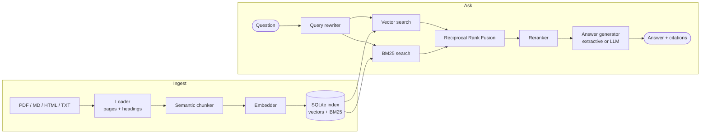
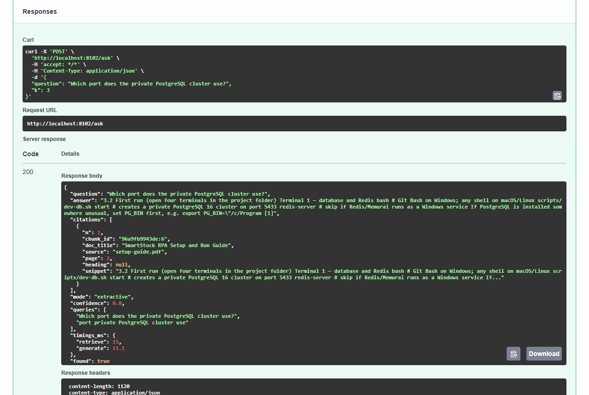

# ragforge

**Hybrid-search RAG for your PDFs and documents: answers with citations, and the numbers to prove retrieval works.**
Semantic chunking, BM25 + vector search fused with Reciprocal Rank Fusion, reranking, query rewriting, cited answers
and a built-in evaluation pipeline. Runs fully offline by default; plug in any OpenAI-compatible LLM when you want
generated answers.

[](https://github.com/SB110604/ragforge/actions/workflows/ci.yml)
[](LICENSE)


## Features

| Stage | What ragforge does |
|---|---|
| **Loading** | PDF (page numbers kept), Markdown (section headings kept, Mermaid diagrams turned into text), HTML, TXT |
| **Semantic chunking** | Splits where the topic shifts (embedding similarity between consecutive sentences), within a token budget; list items and table rows stay intact |
| **Embeddings** | Offline hashing embedder (no download), [FastEmbed](https://github.com/qdrant/fastembed) ONNX models (no GPU / torch), or any `/embeddings` API |
| **Index** | One SQLite file: chunks, metadata and embeddings; exact cosine search in NumPy plus an Okapi BM25 keyword index |
| **Hybrid search** | Vector and BM25 rankings for every query variant, fused with Reciprocal Rank Fusion; optional filtering by document |
| **Query rewriting** | Keyword form, glossary/acronym expansion, sub-queries for comparisons (*A vs B*), optional LLM reformulations |
| **Reranking** | Term coverage + proximity reranker (default) or a neural cross-encoder |
| **Answers** | Extractive answers with `[n]` citations (no LLM), or LLM answers restricted to the sources and cited; says *"I could not find this"* instead of guessing |
| **Evaluation** | Hit rate@k, MRR, answer accuracy (incl. abstention), citation precision and groundedness from a JSONL file |
| **Interfaces** | Python API, `ragforge` CLI, FastAPI service (upload, search, ask, delete) and Docker |

## Architecture



## Quick start

```bash
git clone https://github.com/SB110604/ragforge.git
cd ragforge
python -m venv .venv && source .venv/bin/activate      # Windows: .venv\Scripts\activate
pip install -e ".[dev]"

ragforge ingest examples/docs
ragforge ask "How long are one-click approval tokens valid?"
ragforge eval examples/eval.jsonl
```

Real output on the bundled sample documents (two Markdown guides and a PDF):

```text
indexed architecture.md: 8 page(s), 13 chunks
indexed setup-guide.pdf: 3 page(s), 14 chunks
indexed user-guide.md: 7 page(s), 20 chunks

$ ragforge ask "How long are one-click approval tokens valid?"
before/after values and client IP; one-click approval tokens are hashed, single-use and expire after 48 h. [1] ...
  [1] SmartStock RPA — Architecture (architecture.md, p. 1, Security)
  [2] SmartStock RPA — Architecture (architecture.md, p. 1, Layer by layer)

$ ragforge ask "What is the capital of Australia?"
I could not find this in the indexed documents.
```

### Python

```python
from ragforge import RAGPipeline

rag = RAGPipeline("data/index.db")             # persistent; RAGPipeline() keeps everything in memory
rag.ingest("contract.pdf")
answer = rag.ask("What is the notice period?")
print(answer.answer)
for c in answer.citations:
    print(c.n, c.source, "page", c.page, c.snippet[:80])
```

With an LLM (OpenAI, Ollama, vLLM, LM Studio...) and semantic embeddings:

```python
from ragforge import FastEmbedEmbedder, OpenAICompatibleLLM, RAGPipeline
from ragforge.retrieval import CrossEncoderReranker

rag = RAGPipeline(
    "data/index.db",
    embedder=FastEmbedEmbedder(),                                          # pip install 'ragforge[fastembed]'
    reranker=CrossEncoderReranker(),
    llm=OpenAICompatibleLLM(model="llama3.1", base_url="http://localhost:11434/v1"),
    glossary={"PO": "purchase order"},
)
```

## Evaluation

`examples/eval.jsonl` holds 12 questions about the sample documents, including 2 that the documents cannot answer.
Results from `ragforge eval examples/eval.jsonl` (k = 4), measured on this repository's sample set:

| Configuration | Hit rate@4 | MRR | Answer accuracy | Citation precision | Groundedness |
|---|---|---|---|---|---|
| Hashing embedder + overlap reranker (default, offline) | 1.0 | 0.81 | 1.0 | 0.58 | 1.0 |
| FastEmbed `bge-small-en-v1.5` + overlap reranker | 0.8 | 0.70 | 1.0 | 0.53 | 1.0 |
| FastEmbed + cross-encoder reranker | 0.9 | 0.83 | 1.0 | 0.53 | 1.0 |

The sample set is small and keyword-heavy, which suits BM25 — run the evaluation on **your own** documents and
questions before choosing a configuration. Write cases as one JSON object per line:

```json
{"question": "What is the notice period?", "evidence": "thirty days written notice", "source": "contract.pdf"}
{"question": "Who won the 2011 World Cup?", "answerable": false}
```

## HTTP API

```bash
pip install -e ".[api]"
ragforge ingest examples/docs && ragforge serve            # http://localhost:8000/docs
# or
docker build -t ragforge . && docker run -p 8000:8000 ragforge
```

`POST /documents` (upload), `GET /documents`, `DELETE /documents/{id}`, `POST /search`, `POST /ask`, `GET /health` —
details and examples in [docs/api.md](docs/api.md). Configuration: [.env.example](.env.example).

A real `/ask` call from the Swagger UI on the sample documents — the answer cites the PDF page it came from:



## Project layout

```text
src/ragforge/
  loaders.py     PDF / Markdown / HTML / TXT -> pages with headings
  chunking.py    semantic chunker
  embeddings.py  hashing, FastEmbed and OpenAI-compatible embedders
  store.py       SQLite index, cosine search, BM25
  retrieval.py   query rewriting, hybrid retrieval (RRF), rerankers
  generate.py    extractive and LLM answers with citations
  evaluate.py    retrieval and answer metrics
  pipeline.py    RAGPipeline (ingest / search / ask)
  api.py, cli.py FastAPI service and command line
examples/        sample documents, eval set, PDF builder
tests/           17 tests (loaders, chunking, BM25, retrieval, answers, persistence, evaluation, API, CLI)
```

## Testing

```bash
pytest --cov          # 17 tests, ~92 % coverage
ruff check . && ruff format --check .
```

## Limitations

- Exact vector search is in-memory NumPy: fine for tens of thousands of chunks, not for millions.
- Scanned PDFs need OCR first (ragforge reports them instead of indexing empty pages).
- Extractive answers quote the sources; for fluent summaries configure an LLM.
- The index stores the embedder name and refuses to mix embedders — re-ingest after switching.

## Roadmap

- [ ] Optional ANN back-ends (FAISS, Qdrant, pgvector) for large corpora
- [ ] Incremental re-indexing of changed files
- [ ] Streaming answers in the API
- [ ] LLM-as-judge answer metrics next to the current lexical ones
- [ ] Table-aware PDF extraction

## Contributing

Contributions are welcome — see [CONTRIBUTING.md](CONTRIBUTING.md).

## License

[MIT](LICENSE) © 2026 Sahil Bodke. The sample documents in `examples/docs` come from the author's
[SmartStock RPA](https://github.com/SB110604/smartstock-rpa) project.
